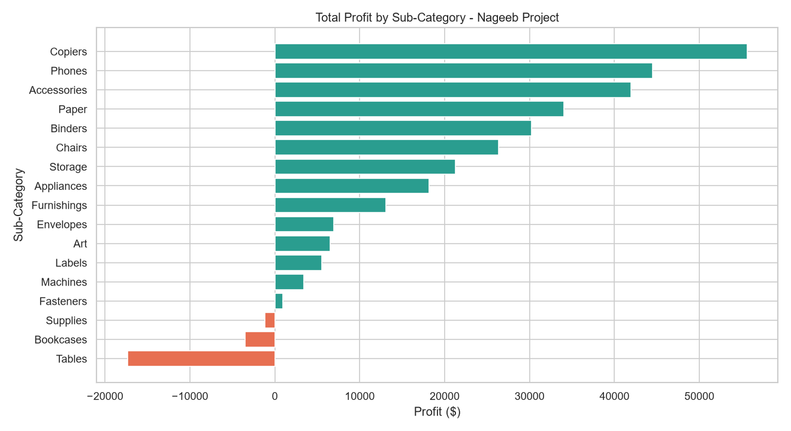
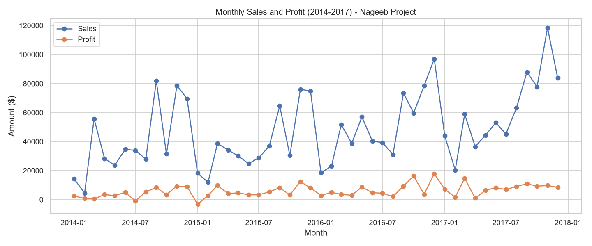
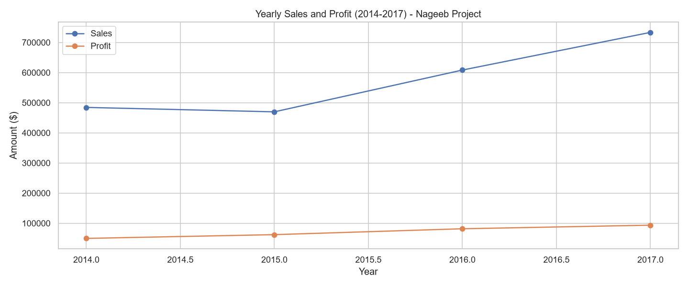
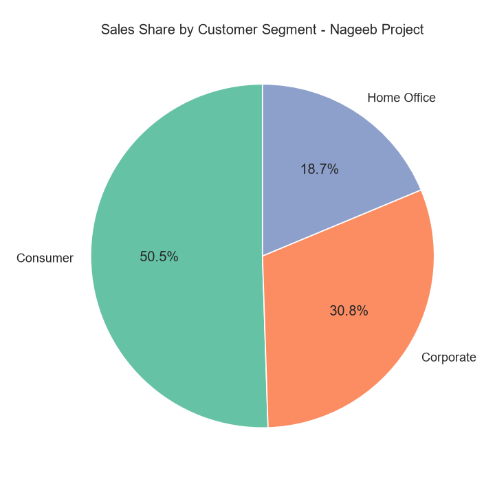
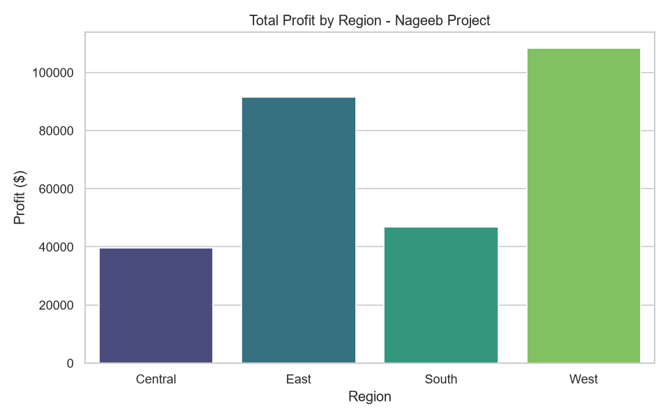
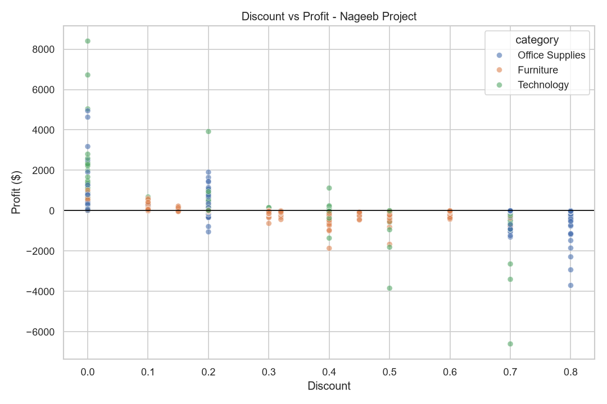
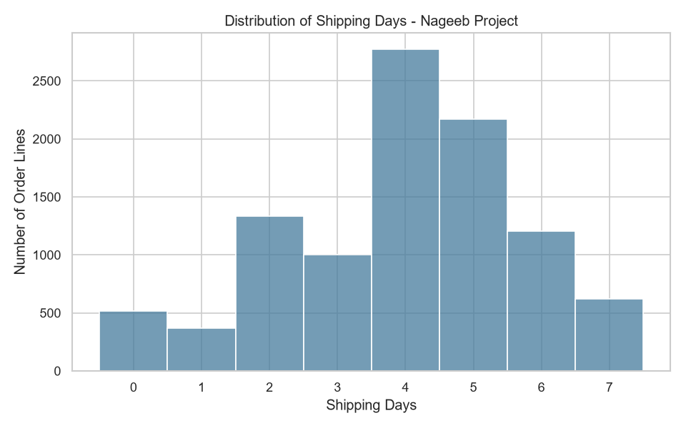

# DONE BY   : Nageeb Yahya Rezq Al-Surmi
# SUPERVISOR: Ms Eman Alsamawi
# COURSE    : Python and Data Analysis


# Project Title: Superstore Sales & Profit Analysis Using Python

## Introduction
A complete data analysis project in Python that studies the sales and profit of a US superstore
to find what drives profit and what causes losses.

## Goal
Understand which products, regions, customer segments and time periods drive sales and profit,
and find the causes of losses, so the store can make better pricing and sales decisions.

## Questions
1. Which categories and sub-categories generate the highest sales and profit, and which ones lose money?
2. How do sales and profit change over time?
3. Which regions and customer segments are the most profitable?
4. How does the discount level affect profit?
5. Which shipping mode is used most, and how long does shipping take?

## Dataset
**Superstore Dataset** from Kaggle: https://www.kaggle.com/datasets/vivek468/superstore-dataset-final
— 9,994 order lines, 21 columns, orders from 2014 to 2017. Saved in `data/superstore.csv`.

## Tools and libraries
Python, VS Code, Pandas, NumPy, Matplotlib, Seaborn.

## Project steps
1. **Project idea and data**: topic, name, goal, questions, dataset.
2. **Data exploration**: read and display the data, shape, columns and types, missing values, duplicates, descriptive statistics.
3. **Data cleaning**: missing values, duplicates, data types, invalid values, column names, unneeded columns.
4. **Data analysis**: filtering, sorting, groupby, aggregation, merge, concat, apply, NumPy calculations, dates.
5. **Data visualization**: bar, line, pie, histogram and scatter charts.
6. **Results and recommendations**.

## Key findings
1. **Technology is the most profitable category** (17.4% margin). Furniture sells almost as much but earns only a 2.5% margin.
2. **Tables, Bookcases and Supplies lose money**. Copiers, Phones and Accessories bring the most profit.
3. **Discounts above 20% lose money on average**: together they lost about $135K.
4. **The West is the best region** (14.9% margin). Central has the lowest margin (7.9%), and Texas, Ohio and Pennsylvania lose the most money.
5. **Sales grew 29.5% in 2016 and 20.4% in 2017**, and peak in September, November and December.

## Recommendations
- Limit discounts to 20% at most.
- Review the pricing and costs of Tables and Bookcases.
- Focus marketing on Technology products.
- Investigate the loss-making states and their discount policy.
- Prepare stock and campaigns before the September–December peak.

## Charts
| | |
|---|---|
|  | 
|  |  |
|  |  |
|  |  |

## Project files
```
├── data/superstore.csv          # dataset
├── images/                      # saved charts
├── superstore_analysis.py       # Python script with all the code
├── .vscode/                     # VS Code settings and recommended extensions
├── requirements.txt             # libraries needed
└── README.md
```

## How to run in VS Code
1. In VS Code choose **File → Open Folder** and open this folder (`Superstore_Analysis_VSCode`).
2. Install the recommended extensions when VS Code asks (**Python**).
3. Open the terminal (**Terminal → New Terminal**) and install the libraries:
   ```bash
   pip install -r requirements.txt
   ```
4. Open `superstore_analysis.py` and click the **Run Python File** button (▶ at the top right).
5. The results are printed in the terminal, the charts are saved in `images/`, and the chart windows
   open at the end. Close the chart windows to end the program.
